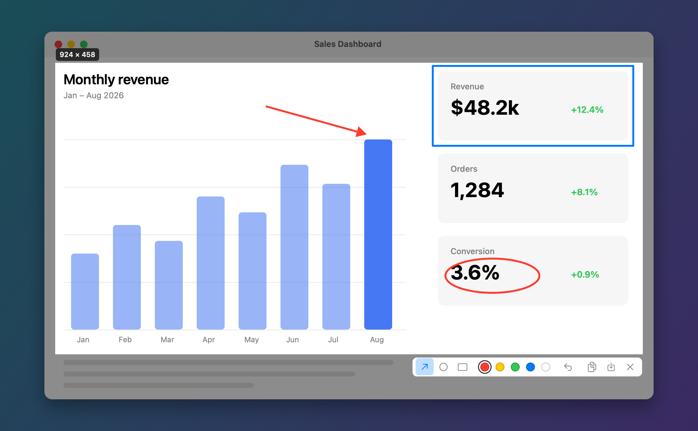

# Snap

A tiny macOS menu bar screenshot tool. Press a shortcut, drag to select, add an arrow, circle or box if you want, then copy or save.

It's a single native Swift app with no dependencies. It uses about **13 MB of memory** while idle and the download is under 1 MB.



*A selected area with an arrow, circle and rectangle drawn on it. The toolbar has the drawing tools, colours, undo, copy, save and cancel.*

## Features

- **Global shortcut** (default `⇧⌘2`). You can change it in Settings.
- **Region select** across multiple displays at full Retina resolution, with the size shown as you drag.
- **Drawing tools:** arrow, circle and rectangle, in 5 colours, with undo.
- **Copy** to the clipboard, or **save** a PNG straight into a folder you choose.
- **Open at Login** option.
- Lives in the menu bar only, with no Dock icon.

## Download and install

1. Download **`Snap.zip`** from the [latest release](https://github.com/frzkhan/snap/releases/latest).
2. Unzip it and drag **Snap.app** into your **Applications** folder.
3. Open Snap. A camera icon appears in the menu bar.

Requires macOS 14 (Sonoma) or later. Works on Apple Silicon and Intel Macs.

### "Snap can't be opened" / "Apple could not verify…"

Snap isn't notarized by Apple (that needs a paid developer account), so macOS blocks it the first time. To allow it:

- Open **System Settings → Privacy & Security**, scroll down, and click **Open Anyway** next to the Snap message. Then open Snap again.

Or, in Terminal:

```bash
xattr -dr com.apple.quarantine /Applications/Snap.app
```

### Screen Recording permission

macOS asks for permission the first time you take a screenshot. Turn on **Snap** under **System Settings → Privacy & Security → Screen & System Audio Recording**, then press the shortcut again. If macOS asks you to quit and reopen Snap, do that.

## Usage

Press **`⇧⌘2`**, or click the menu bar icon and choose **Capture Region**. The screen freezes. Drag to select an area, and a toolbar appears next to it.

| Action | Toolbar | Key |
| --- | --- | --- |
| Arrow tool | ↗ | `A` |
| Circle tool | ◯ | `O` |
| Rectangle tool | ▭ | `R` |
| Pick colour | colour dots | `1`–`5` |
| Undo last shape | ↩ | `⌘Z` |
| Copy to clipboard | ⧉ | `Return` or `⌘C` |
| Save to folder | ⤓ | `⌘S` |
| Cancel | ✕ | `Esc` |

- Hold **Shift** while drawing to make perfect squares and circles, or to snap arrows to 45°.
- Click an active tool again to turn it off. With no tool selected, dragging makes a new selection.

## Settings

Choose **Settings…** from the menu bar icon.

- **Capture shortcut:** click the field and press the new combination. It needs at least one of `⌘`, `⌥` or `⌃`, or it can be a function key on its own. **Reset** goes back to `⇧⌘2`.
- **Save screenshots to:** choose the folder that **Save** writes to. The default is your Desktop. Files are named like `Screenshot 2026-11-10 at 14.32.05.png`.

The menu also has **Open Screenshots Folder** and **Open at Login**.

## Build from source

You need the Xcode command-line tools (`xcode-select --install`).

```bash
git clone https://github.com/frzkhan/snap.git
```

```bash
cd snap && ./build.sh install
```

- `./build.sh` builds `build/Snap.app` (a universal binary).
- `./build.sh install` also copies it to `/Applications` and launches it.
- `./build.sh release` also creates `build/Snap.zip` for a GitHub release.

Every rebuild is signed again ad-hoc, so macOS may ask for Screen Recording permission again after you rebuild.

### Project layout

| File | What it does |
| --- | --- |
| `Sources/main.swift` | App entry point, menu bar item and menu |
| `Sources/Capture.swift` | Screen capture (ScreenCaptureKit), copy/save, toast |
| `Sources/Overlay.swift` | Selection overlay, drawing tools, toolbar, export |
| `Sources/Settings.swift` | Preferences, global hotkey, shortcut recorder, Settings window |
| `Resources/AppIcon.icns` | App icon (generated by `swift scripts/make-icon.swift`) |
| `scripts/make-demo.sh` | Re-renders `docs/screenshot.png` from the real overlay code |
| `build.sh` | Builds, installs or packages the app |
